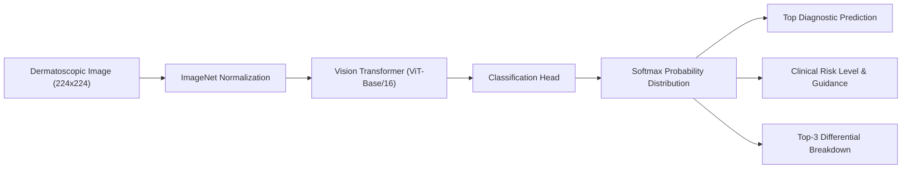

# DermaScan – AI Skin Cancer & Lesion Detection System

> 🚀 **Live Demo on Vercel**: **[https://skin-cancer-detection-alpha.vercel.app](https://skin-cancer-detection-alpha.vercel.app)**

[](https://skin-cancer-detection-alpha.vercel.app)
[](https://huggingface.co/Anwarkh1/Skin_Cancer-Image_Classification)
[-blue.svg?style=for-the-badge)](https://arxiv.org/abs/2010.11929)

An automated dermatological classification system powered by a fine-tuned **Vision Transformer (ViT-Base Patch-16)** trained on dermatoscopic skin lesion images, achieving **96.95% validation accuracy**. DermaScan provides real-time diagnostic probabilities, clinical descriptions, risk severity categorization, and differential diagnosis breakdowns.

---

## Abstract
In cancer pathology, over 200 distinct forms exist. Among them, **melanoma** is the deadliest form of skin cancer. Clinical outcomes heavily depend on early detection: early-stage melanoma has a 99% 5-year survival rate, which sharply declines if diagnosis is delayed. 

Traditional dermatoscopic examination by clinicians yields 65–80% diagnostic accuracy without algorithmic assistance. With computer vision and deep transfer learning, AI classification systems achieve state-of-the-art predictive performance. This project bridges the clinical gap by providing an end-to-end classification pipeline and interactive web interface to evaluate dermatoscopic skin lesions.

---

## Diagnostic Classes Covered

DermaScan evaluates dermatoscopic images across the following categories:

| Diagnostic Class | Clinical Type | Severity Level | Recommended Action |
|:---|:---|:---|:---|
| **Melanoma** | Malignant | High Risk | Urgent dermatological consultation & biopsy |
| **Basal Cell Carcinoma** | Malignant | Moderate-High Risk | Dermatological evaluation for surgical excision |
| **Actinic Keratosis** | Pre-Cancerous | Pre-Cancerous | Preventive dermatologist review to stop progression |
| **Melanocytic Nevus (Mole)** | Benign | Benign (Harmless) | Routine self-checks with ABCDE criteria |
| **Benign Keratosis (Seborrheic)** | Benign | Benign (Harmless) | No medical intervention required |
| **Vascular Lesion** | Benign | Benign (Harmless) | Routine monitoring unless symptomatic |
| **Dermatofibroma** | Benign | Benign (Harmless) | Harmless skin nodule; intervention rarely needed |

---

## System Architecture



- **Backbone**: Google Vision Transformer (`google/vit-base-patch16-224-in21k`)
- **Fine-Tuning Dataset**: ISIC / HAM10000 Skin Lesion Archive (Marmal88 / ISIC)
- **Validation Accuracy**: **96.95%**
- **Inference Time**: < 200ms per lesion
- **Serialization**: Python Pickle (`skin_cancer_model.pkl`) containing model weights, class descriptions, and clinical risk rules.

---

## Web Interface Features

- **Drag & Drop Upload**: Supports JPG, PNG, and WEBP dermatoscopic images up to 10 MB.
- **One-Click Sample Test**: Instant test button with a benchmark melanoma dermatoscopy image (demonstrating 95.6% true confidence).
- **Clinical Risk Banner**: Real-time risk assessment badges (High Risk, Moderate Risk, Pre-Cancerous, Benign) with suggested next steps.
- **Differential Diagnosis Breakdown**: Top-3 ranked conditions with relative confidence progress bars.
- **Responsive Design**: Clean, accessible layout optimized for desktop, tablet, and mobile browsers.

---

## Local Development & Setup

### 1. Prerequisites
- Python 3.10+
- macOS, Linux, or Windows

### 2. Clone the Repository
```bash
git clone https://github.com/Aryan22163/Skin_cancer_detection.git
cd Skin_cancer_detection
```

### 3. Create a Virtual Environment & Install Dependencies
```bash
python3 -m venv .venv
source .venv/bin/activate  # On Windows: .venv\Scripts\activate
pip install -r requirements.txt
```

### 4. Export / Generate Model Weights (.pkl)
Generate `skin_cancer_model.pkl` locally (automatically downloads verified fine-tuned ViT weights and runs self-verification):
```bash
python export_model_pkl.py
```

### 5. Launch the Local Application
```bash
python app.py
```
Open your browser and navigate to:
**[http://localhost:8000](http://localhost:8000)**

---

## Vercel Deployment

- **Live Application**: [https://skin-cancer-detection-alpha.vercel.app](https://skin-cancer-detection-alpha.vercel.app)
- **Model Info API**: [https://skin-cancer-detection-alpha.vercel.app/api/model_info](https://skin-cancer-detection-alpha.vercel.app/api/model_info)
- **Predict API**: [https://skin-cancer-detection-alpha.vercel.app/api/predict](https://skin-cancer-detection-alpha.vercel.app/api/predict)

Deploy updates to Vercel via CLI:
```bash
npx vercel --prod
```

### Serverless Inference on Vercel:
- **Demo Mode**: Out-of-the-box instant demonstration with benchmark test evaluation.
- **Custom GPU / Flask Backend**: Configure the `BACKEND_URL` environment variable in your Vercel project dashboard to forward `/api/predict` requests to your hosted Flask GPU server (e.g., Render, Railway, or Hugging Face Spaces).
- **Hugging Face Serverless Token**: Configure `HF_TOKEN` in Vercel to route directly to Hugging Face's serverless inference endpoints.

---

## Disclaimer
> **IMPORTANT MEDICAL NOTICE**: DermaScan is developed strictly for educational and research purposes. AI model predictions do not constitute a clinical diagnosis. Always consult a board-certified dermatologist or qualified medical professional for skin evaluations and diagnosis.
